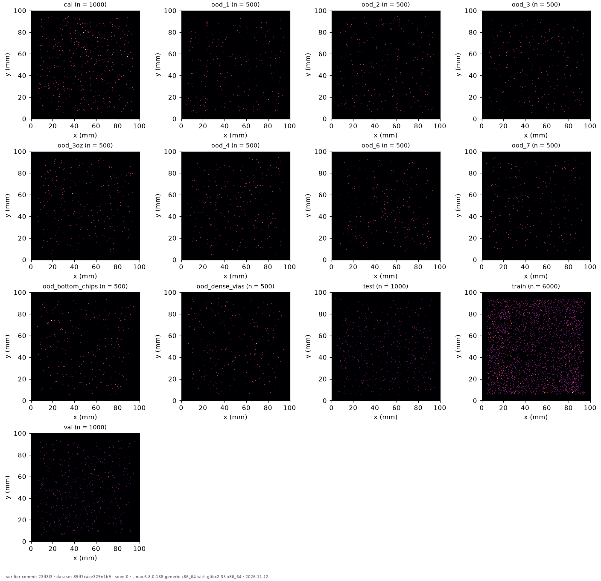
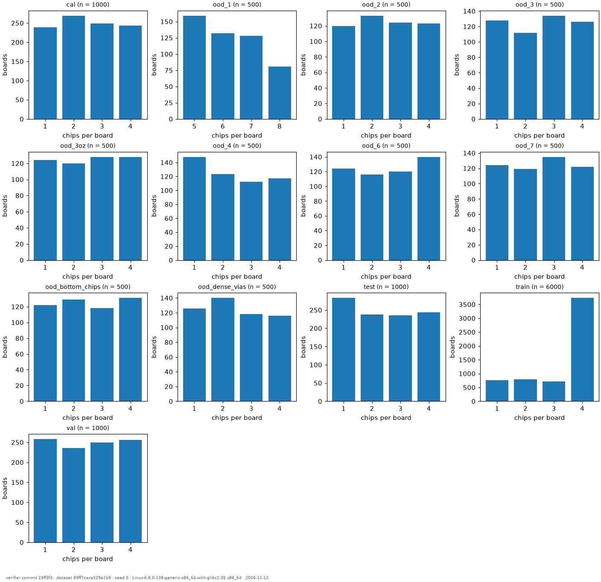

# Dataset verification (N2.2): PASS

Root `/media/rvcse22/CSERV/twinheat/dataset_v1` · dataset hash `89ff7cace329e1b982c33f3eb633dbc53242266eaeea9b2a1e4acc251829e5c7`

Checks: file hashes and counts; provenance; record hashes and cross-split duplicates; re-solve of 1% of each split (at least one board) with PyAMG-GMRES to 1e-10 (limit 0.002 of max θ); statistics (mean φ rasterised at N = 64).

| split | boards | shards | commit | rescaled | θ_max P5 / P50 / P95 (K) | re-solved | worst rel. error | mean φ L1 / L2 / L3 / L4 | chips per board |
|---|---|---|---|---|---|---|---|---|---|
| cal | 1000 | 2 | da2c2b6 | 0.7% | 2.7 / 19.8 / 62.6 | 10 | 4.39e-04 | 0.198 / 0.935 / 1.000 / 0.173 | 1: 239, 2: 269, 3: 249, 4: 243 |
| ood_1 | 500 | 1 | da2c2b6 | 1.6% | 17.5 / 42.0 / 81.1 | 5 | 4.34e-04 | 0.199 / 0.938 / 1.000 / 0.171 | 5: 159, 6: 132, 7: 128, 8: 81 |
| ood_2 | 500 | 1 | da2c2b6 | 41.0% (exempt) | 41.6 / 90.3 / 100.0 | 5 | 3.98e-04 | 0.199 / 0.936 / 1.000 / 0.174 | 1: 120, 2: 133, 3: 124, 4: 123 |
| ood_3 | 500 | 1 | da2c2b6 | 1.2% | 3.0 / 22.1 / 64.7 | 5 | 4.54e-04 | 0.140 / 0.932 / 1.000 / 0.172 | 1: 128, 2: 112, 3: 134, 4: 126 |
| ood_3oz | 500 | 1 | da2c2b6 | 0.4% | 2.8 / 19.5 / 64.4 | 5 | 4.43e-04 | 0.197 / 0.937 / 1.000 / 0.172 | 1: 124, 2: 120, 3: 128, 4: 128 |
| ood_4 | 500 | 1 | da2c2b6 | 0.4% | 2.6 / 19.6 / 65.5 | 5 | 4.03e-04 | 0.182 / 0.939 / 1.000 / 0.166 | 1: 148, 2: 123, 3: 112, 4: 117 |
| ood_6 | 500 | 1 | da2c2b6 | 0.4% | 2.4 / 13.5 / 47.4 | 5 | 4.73e-04 | 0.198 / 0.938 / 1.000 / 0.177 | 1: 124, 2: 116, 3: 120, 4: 140 |
| ood_7 | 500 | 1 | da2c2b6 | 7.0% | 3.9 / 29.4 / 100.0 | 5 | 4.78e-04 | 0.199 / 0.931 / 1.000 / 0.174 | 1: 124, 2: 119, 3: 135, 4: 122 |
| ood_bottom_chips | 500 | 1 | 23ff3f3 | 0.4% | 2.4 / 20.5 / 62.0 | 5 | 4.39e-04 | 0.197 / 0.937 / 1.000 / 0.173 | 1: 122, 2: 129, 3: 118, 4: 131 |
| ood_dense_vias | 500 | 1 | da2c2b6 | 0.6% | 2.9 / 19.7 / 62.1 | 5 | 4.24e-04 | 0.199 / 0.931 / 1.000 / 0.166 | 1: 126, 2: 140, 3: 118, 4: 116 |
| test | 1000 | 2 | da2c2b6 | 0.5% | 2.2 / 20.7 / 65.9 | 10 | 4.19e-04 | 0.194 / 0.936 / 1.000 / 0.173 | 1: 283, 2: 238, 3: 235, 4: 244 |
| train | 6000 | 12 | da2c2b6 | 0.4% | 4.4 / 44.0 / 61.8 | 60 | 4.76e-04 | 0.226 / 0.968 / 1.000 / 0.184 | 1: 758, 2: 788, 3: 721, 4: 3733 |
| val | 1000 | 2 | da2c2b6 | 1.2% | 2.4 / 21.4 / 67.4 | 10 | 4.38e-04 | 0.196 / 0.936 / 1.000 / 0.169 | 1: 258, 2: 236, 3: 250, 4: 256 |

Cross-split duplicate records: 0.
Rescale exemption for ood_2: docs/decisions.md, 'Dataset v1: OOD-2 envelope rescale above 20 %'.

## Problems

None.

## Figures

---

verifier commit 23ff3f3 · dataset 89ff7cace329e1b9 · seed 0 · Linux-6.8.0-138-generic-x86_64-with-glibc2.35 x86_64 · 2026-11-12
